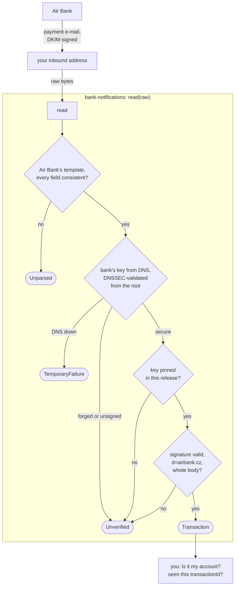

# How verification works

Anyone can send an e-mail that says it is from a bank. What makes a bank's e-mail trustworthy is its
[DKIM](https://www.rfc-editor.org/rfc/rfc6376) signature: the bank signs the headers and the body with a key whose public
half it publishes in DNS. The library verifies it before it hands out a `Transaction`.

## The checks, in order

Every arrow out of the box but one ends in an exception. A `Transaction` exists only when all four checks passed, with
no setting to forget. The two questions at the bottom stay with you, see [usage](usage.md#two-checks-stay-with-you).

## What counts

A signature counts only when all of these hold, besides [whose key it is](#whose-key-it-is):

- it verifies over the **raw bytes**, recomputed here; an `Authentication-Results` header that came with the message
  is never read, because whoever sent the message could have written it;
- its `d=` is the domain of the bank whose template matched (`airbank.cz` for Air Bank);
- it signs the **whole body**: a signature with `l=` covers only the first bytes, and anything could follow them;
- its key is not in testing mode (`t=y` in the key record);
- an RSA key has at least 1024 bits, the shortest [RFC 8301](https://www.rfc-editor.org/rfc/rfc8301) lets a verifier
  accept; Air Bank's is 1024 (2026-11-10). `DkimVerifier.minimumKeyBits` raises it for a direct caller.

A key lookup that fails (a timeout, a resolver error) throws `TemporaryFailure`, never `Unverified`: the e-mail may be
perfectly genuine.

## Whose key it is

A valid signature only proves the e-mail was signed with the key DNS handed out. Two more checks make sure that key is
the bank's, and `BankNotifications.withDns()` does both without being asked:

- **DNSSEC, validated here.** The key's DNS answer has to be DNSSEC-secure, and the library validates it itself, from the
  root zone's trust anchors (IANA's KSK-2017 and KSK-2024) down, instead of trusting the machine's resolver. An unsigned
  zone, a forged answer, a broken signature chain and a resolver that strips the signatures are all refused.
  `airbank.cz` is signed, and so is its key record (2026-11-10).
- **The key is pinned.** Each bank's key fingerprints are written in the code (`AirBank.KEY_FINGERPRINTS`, the SHA-256
  of the public key), and only those are accepted, whatever DNS says. Forging a key would take breaking DNSSEC *and*
  holding the bank's private key. `BankNotifications.pinnedKeys()` lists them.

The price of pinning: **when a bank rotates its key, a release that does not know the new one throws `Unverified` for
that bank's e-mails** until you upgrade. Nothing is lost, the e-mails are still there to read again; `.github/workflows/keys.yml`
compares the pins with DNS every day and opens an issue the day a bank publishes another key, so a release follows.
`make check-keys` runs the same check by hand.

`BankNotifications.trustingKeysFrom(lookup)` skips both, by name: for tests, which sign with a key of their own, and for
a resolver you vouch for yourself.

## What it does not prove

That the e-mail is about your account; that it was not delivered before. Those are the two
[checks that stay with you](usage.md#two-checks-stay-with-you).

## Underneath

[Apache James jDKIM](https://github.com/apache/james-jdkim) 0.5 (`org.apache.james.jdkim:apache-jdkim-library`, released
June 2025) does the cryptography and the RFC 6376 canonicalisation; the package `cz.insuit.bank.notification.dkim` wraps
it with the rules above. No jDKIM type is part of the API, so it can be replaced without changing a caller.

Checked on 2026-11-10: the repository is active (commits on 2026-11-05), no known vulnerability in OSV for 0.5 or for
what it brings (dnsjava 3.6.3, mime4j 0.8.12), Java 8 bytecode. jDKIM's verifier keeps its results on the instance, so
the wrapper makes one per message; `BankNotifications` and `DkimVerifier` are thread-safe.

## The size limit

jDKIM's maintainers fixed parsing that was not linear in its input on 2026-11-05 (the `g=` check and the space after a
header name), after 0.5. Those fixes are not released yet. Since anyone can send mail to the address these e-mails come
to, the library refuses messages over 64 KiB before parsing them. The limit goes up once a jDKIM release carries the
fixes.
