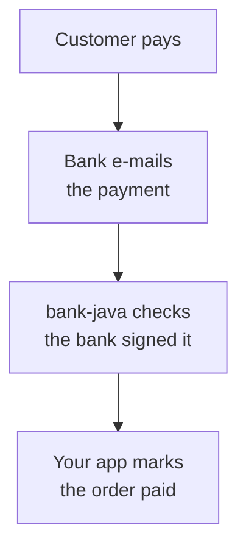

# bank-java

**Know the moment a customer pays you, without a bank API.**

Czech banks can send an e-mail for every payment that moves on an account. This library turns that e-mail into a
payment your application can act on: who paid, how much, with which variable symbol. Match it to an invoice or an
order and mark it paid, automatically, about a minute after the money lands.

- **No contract with the bank, no API key, no PSD2 licence.** The account holder switches the e-mail on in their own
  internet banking and sends it to an address your application receives.
- **A forged e-mail is never taken for a payment.** Only an e-mail the bank itself signed gets through; anything else
  is refused, with no setting to forget. See [how verification works](.docs/verification.md).
- **Money in and money out.** Incoming payments to match, outgoing ones to see the account move.
- **Air Bank and Fio banka in Czechia**, more banks to follow; [Fio in Slovakia](https://github.com/landsman/bank-java/issues/10) is next.

For Java 21+ and Kotlin, one jar, no framework required.

## What it covers

✅ read, ⬜ not yet, ❔ no real e-mail has shown it yet. MONETA and Creditas are read from public samples only. Details per bank:
[Air Bank](.docs/air-bank.md), [Fio CZ](.docs/fio-cz.md), [MONETA](.docs/moneta.md), [Creditas](.docs/creditas.md).

| Feature | Air Bank | Fio banka CZ | MONETA | Creditas |
|---|:---:|:---:|:---:|:---:|
| Incoming payment | ✅ | ✅ | ❔ | ❔ |
| Outgoing payment | ✅ | ✅ | ❔ | ❔ |
| Card payment | ❔ | ✅ | ❔ | ⬜ holds refused |
| Direct debit | ❔ | ✅ | ❔ | ❔ |
| Amount | ✅ below 1 000 so far | ✅ | ❔ | ❔ |
| Who paid: name and account | ✅ | ✅ | ❔ account only | ❔ account only |
| Variable symbol | ✅ | ✅ | ❔ from Popis | ❔ |
| Message for the recipient | ✅ | ✅ | ❔ | ⬜ |
| Date and transaction id | ✅ | ✅ | ❔ date only | ❔ date only |
| Balance after the payment | ✅ below 1 000 so far | ✅ | ⬜ | ❔ |
| Proven to come from the bank | ✅ | ✅ | ⬜ no key yet | ⬜ no key yet |

Other banks: not yet.

## Docs

| Read | For |
|---|---|
| [Setting up a bank](.docs/setup.md) | what the account holder clicks in their internet banking |
| [Installing](.docs/install.md) | adding the library to a Gradle or Maven project |
| [Using the library](.docs/usage.md) | reading an e-mail, the failures, a payment's fields, the two checks left to you |
| [How verification works](.docs/verification.md) | why a forged e-mail cannot pass |
| [How Air Bank's e-mail behaves](.docs/air-bank.md) | what the bank sends and what has not been seen yet |
| [How Fio CZ's e-mail behaves](.docs/fio-cz.md) | the same for Fio banka in Czechia |
| [How MONETA's e-mail behaves](.docs/moneta.md) | the same for MONETA, from public samples |
| [How Creditas's e-mail behaves](.docs/creditas.md) | the same for Creditas, from public samples |
| [Roadmap](.docs/plan/roadmap.md) | what is next |
| [Development](.docs/development.md) | building it, adding a bank |
| [llms.txt](llms.txt) | for a coding assistant adding the library to a project |

Licence: [Apache 2.0](LICENSE)
